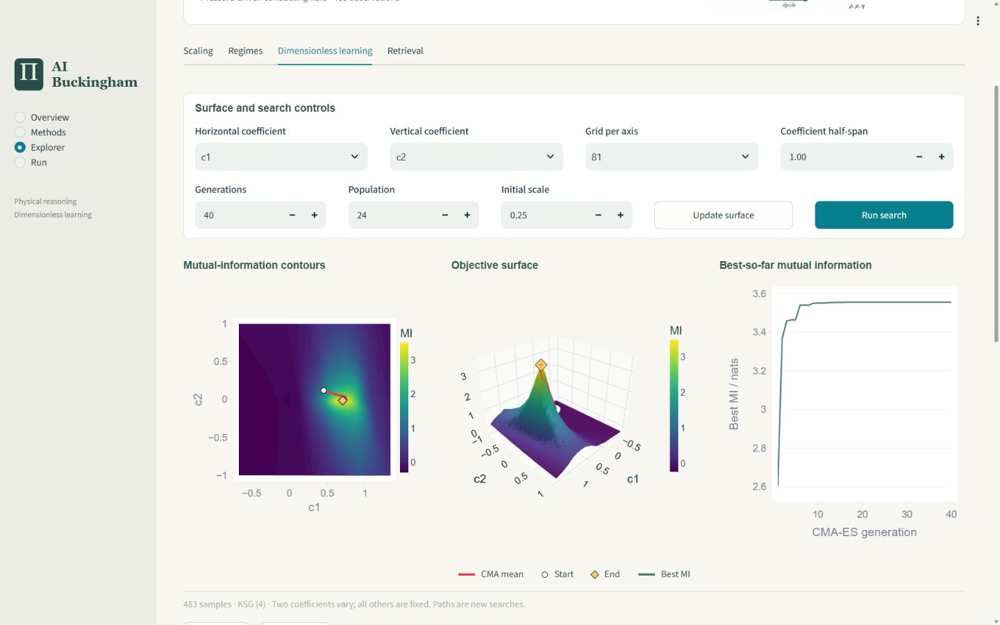
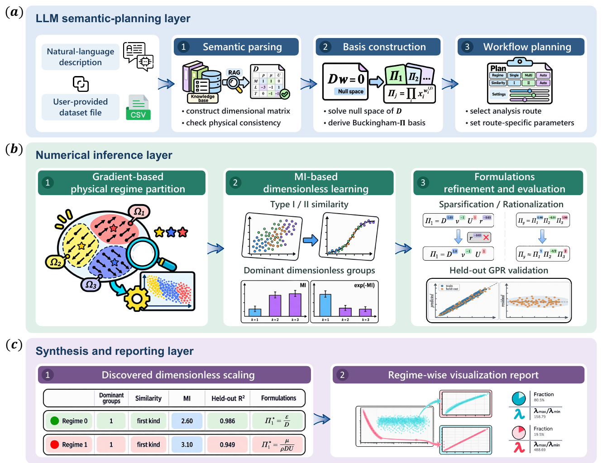
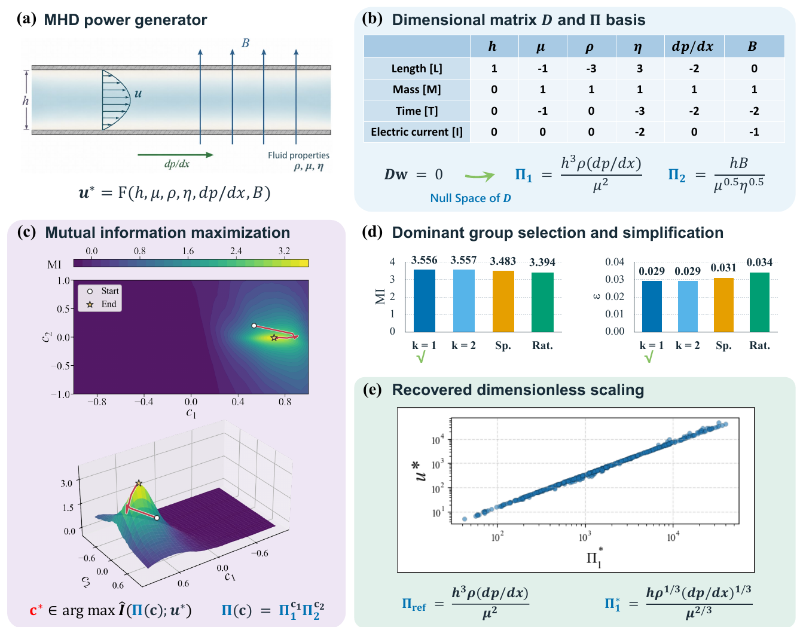
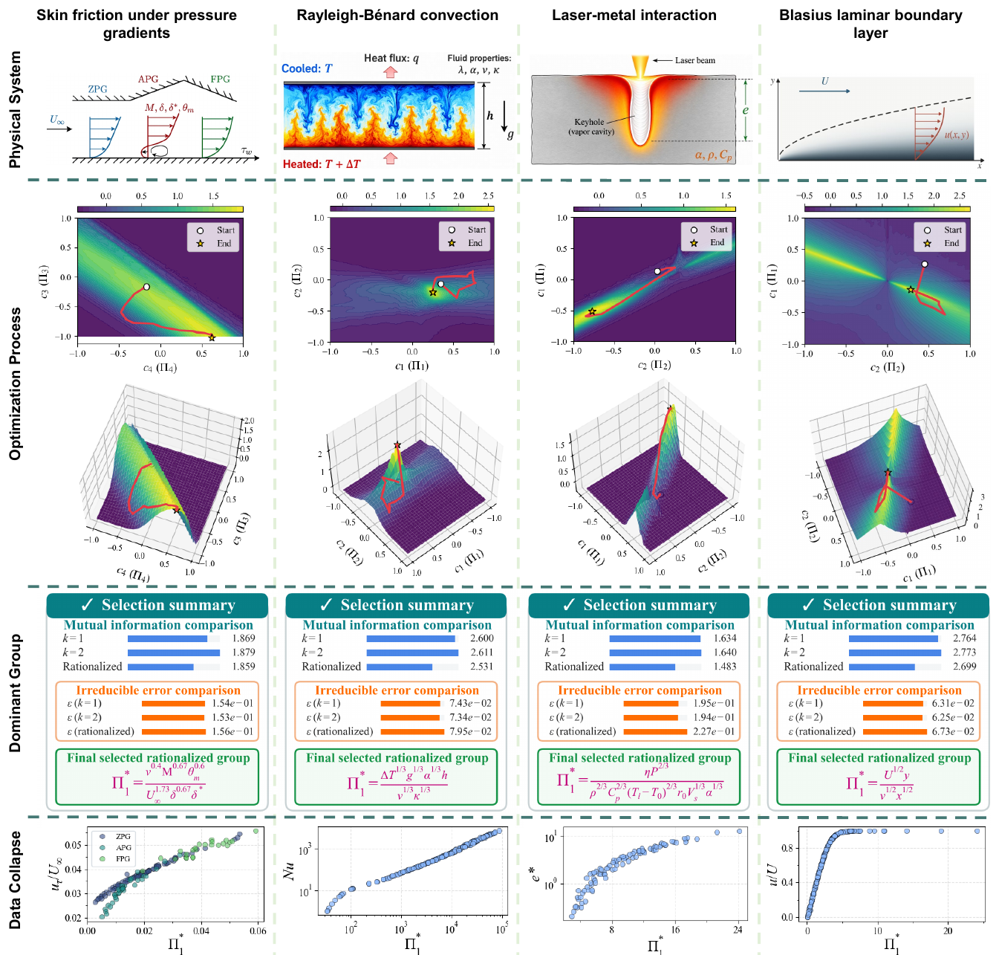
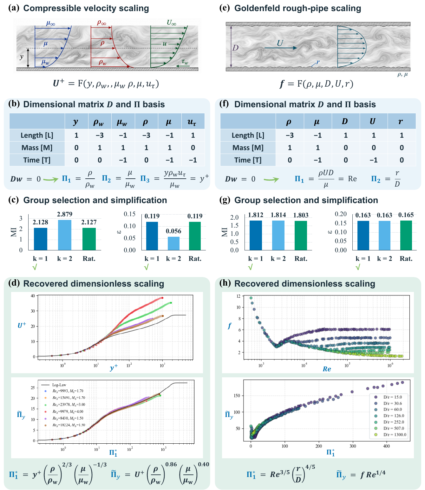
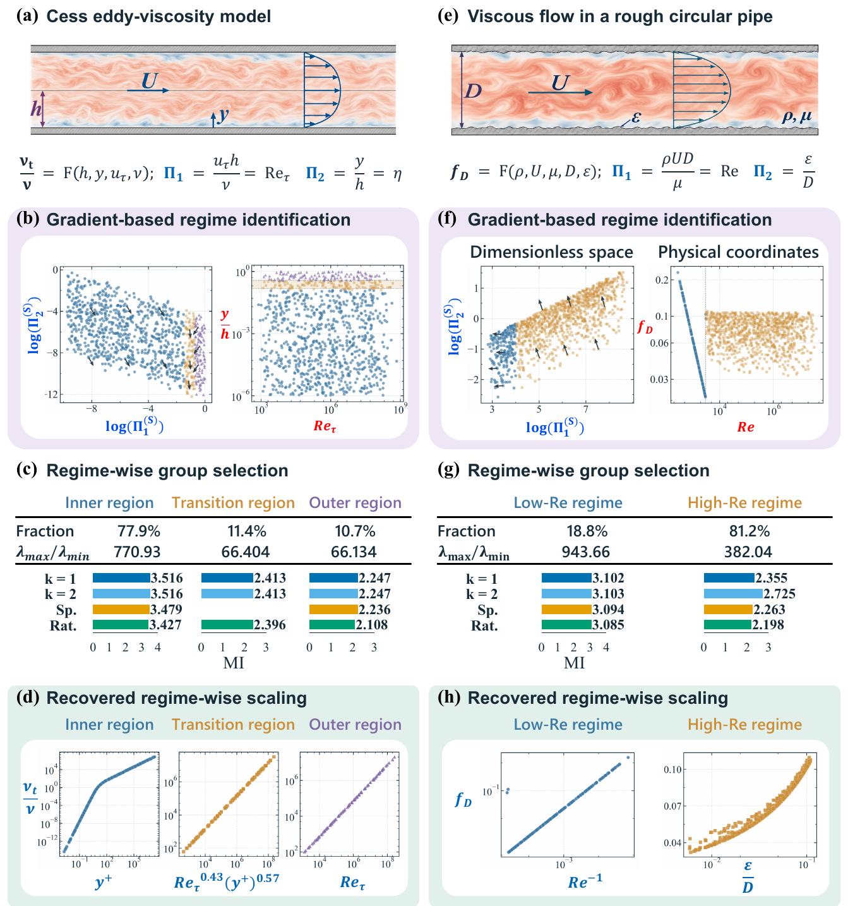

<div align="center">

# AI Buckingham

**Agentic data-driven physics and dimensionless learning**

Ao Cheng · Lei Zhang · Guowei He

[Streamlit app](#streamlit-app) · [Research figures](#selected-results) · [Parameters](docs/PARAMETERS.md) · [Deployment](docs/DEPLOYMENT.md)

</div>

Discover physical scaling laws through LLM-based orchestration, gradient-based physical-regime identification and mutual-information-based dimensionless learning. AI Buckingham bridges global and multiple physical regimes and identifies Type I and Type II similarity.

## Streamlit app

[](docs/assets/streamlit-explorer.png)

- **Methods:** analytical GPR gradients, eigenpair clustering, MI estimators and searchable physical knowledge bases.
- **Explorer:** nine physical systems, response collapse, dimensional bases, regime geometry, contour/surface views, convergence and validation.
- **Run:** autonomous discovery or inference with a supplied Π basis; upload a CSV, edit the problem and configure scientific settings, models and API endpoints.

```bash
python -m venv .venv
# Git Bash on Windows: source .venv/Scripts/activate
# macOS / Linux: source .venv/bin/activate
python -m pip install -e ".[app]"
python -m streamlit run app.py
```

Offline exploration requires no API keys. To host the app, connect this repository to **Streamlit Community Cloud**, select **`app.py`**, and follow the [deployment guide](docs/DEPLOYMENT.md#streamlit-community-cloud). GitHub Pages presents the static research site; Streamlit runs the interactive Python application.

## Framework



Retrieval-grounded physical reasoning establishes the variables and dimensional basis. Analytical GPR gradients identify physical regimes. MI-based optimization learns compact groups, followed by sparsification, rationalization and conditional predictive evaluation.

## Selected results

Original result artwork from the authors. Select an image to inspect it at full resolution.

<table>
<tr>
<td width="50%" valign="top"><a href="docs/assets/results/mhd.png"></a><br><strong>MHD duct flow</strong><br>Dimensional learning, MI optimization and compact scaling.</td>
<td width="50%" valign="top"><a href="docs/assets/results/complete-similarity.png"></a><br><strong>Complete similarity</strong><br>Pressure-gradient friction, convection, keyhole depth and the Blasius boundary layer.</td>
</tr>
<tr>
<td width="50%" valign="top"><a href="docs/assets/results/incomplete-similarity.png"></a><br><strong>Incomplete similarity</strong><br>Compressible velocity and Goldenfeld rough-pipe scaling.</td>
<td width="50%" valign="top"><a href="docs/assets/results/multiple-regimes.png"></a><br><strong>Multiple physical regimes</strong><br>Gradient geometry and regime-wise learning in the Cess and rough-pipe systems.</td>
</tr>
</table>

The [GitHub Pages presentation](docs/index.html) adds interactive response plots, MI landscapes, search trajectories and validation values. Publish its `docs/` directory using the included [Pages workflow](.github/workflows/pages.yml).

## Physical systems

| Similarity | Systems | Raw observations |
|---|---|---:|
| Type I | MHD duct flow; pressure-gradient friction; Rayleigh–Bénard convection; laser keyhole depth; Blasius boundary layer | 1,099 |
| Type II | Compressible velocity; Goldenfeld rough-pipe scaling | 1,523 |
| Multiple regimes | Cess eddy viscosity; rough circular pipe | 2,200 |

Total: **4,822 observations** across nine systems. The original near-zero filter leaves 196 Blasius and 1,103 compressible-velocity samples. Original CSVs and knowledge bases retain their SHA-256 records. See [data sources](docs/DATA_SOURCES.md).

## Configuration and execution

The supplied article and supplementary settings take precedence over inconsistent source-code defaults. Complete resolved case configurations are in [`configs/paper/`](configs/paper/).

| Component | Setting |
|---|---|
| LLM | `gpt-5-mini`; requested temperature 0 |
| CMA-ES | seed 42; 3 runs; population 300; maximum 30,000 generations |
| MI | KSG below N=800, histogram otherwise; default neighbors=5 / bins=40 |
| GPR | 5 optimizer restarts; maximum 500 optimizer iterations |
| Regimes | K in {2,3,4}; ≥60 samples; ≥5% fraction; eigenvalue ratio ≥50 |
| Directional support | K=2 absolute cosine <0.90; coarsest admissible partition |
| Type I/II screen | k=1; relative MI-loss limit 0.15 |
| Group count | minimum absolute decrease in exp(−MI): 0.10 |
| Simplification | exponent cutoff 0.05; rationalization relative MI-loss limit 0.10 |
| Validation | three 80/20 splits; maximum 800 samples; mean R² ≥0.90 |

[Full settings and case overrides](docs/PARAMETERS.md) · [Code parameter inventory](configs/parameter_inventory.csv) · [Reproducibility](docs/REPRODUCIBILITY.md)

```bash
# Numerical inference with the supplied dimensional basis; no API calls
ai-buckingham numerical --case mhd --output results/local/mhd.json
ai-buckingham regimes --case cess --output results/local/cess.json

# Autonomous discovery; configure credentials locally first
ai-buckingham agent --case mhd --output results/local/agent.json
```

Copy `.env.example` to an untracked `.env` for API runs. Chat defaults to `https://api.chatanywhere.tech/v1`; embeddings use `GLM-Embedding-3` at `https://llmapi.paratera.com/v1`. `OPENAI_BASE_URL` takes precedence over `OPENAI_API_BASE`. LangSmith tracing is opt-in. The app also accepts credentials and endpoints in Run. No real credentials are distributed.

## Results and reproducibility

- `results/reference/`: supplied result values, including uncertainty and validation outcomes.
- `results/computed/`: configured gradient diagnostics for all nine cases.
- `results/previews/`: computed MI slices and reduced-budget search trajectories, with exact subset records.
- `results/local/`: ignored local runs, including effective settings, seed and dataset hash.

The seven global systems have 81 × 81 two-coefficient MI slices and recorded CMA-ES paths. Cess and pipe have separate slices and searches for each computed physical regime. These are fixed objective slices; full 30,000-generation discovery has not been rerun for every case. Original agent sessions and row-level reference labels were not supplied. The current pipe partition has 971/229 samples, compared with the supplied 975/225 result; the two records remain distinguishable.

The rationalized pipe regime with supplied **R² = −3.079** remains visible as a failed validation. Held-out R² evaluates the selected representation, not the entire discovery process. Offline retrieval uses the labeled lexical path; autonomous runs expose their actual retrieval records.

## Development

```bash
python -m pip install -e ".[app,dev]"
python -m pytest -q
python scripts/validate_repository.py
```

See [architecture](docs/ARCHITECTURE.md) and [deployment](docs/DEPLOYMENT.md). `requirements-lock.txt` records the Windows/Python 3.13 preparation environment.

The public release includes source code, benchmark data, selected original figure images and an app preview. **Full manuscript documents, editable slides, authoring notebooks, credentials, environments and internal delivery files are excluded.** The release builder uses an explicit file allowlist and generates a SHA-256 manifest.

## Citation and rights

Use [CITATION.cff](CITATION.cff) for the software authors and title. No publication DOI is claimed. [LICENSE](LICENSE) records the current rights notice; data and third-party source material retain their existing rights.
