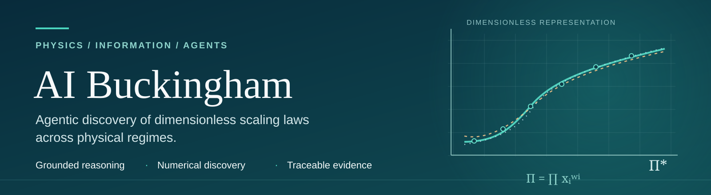
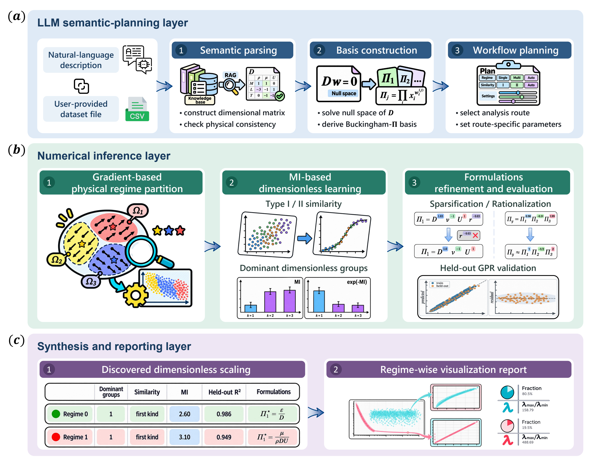
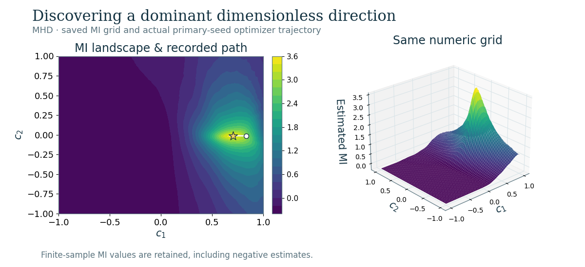
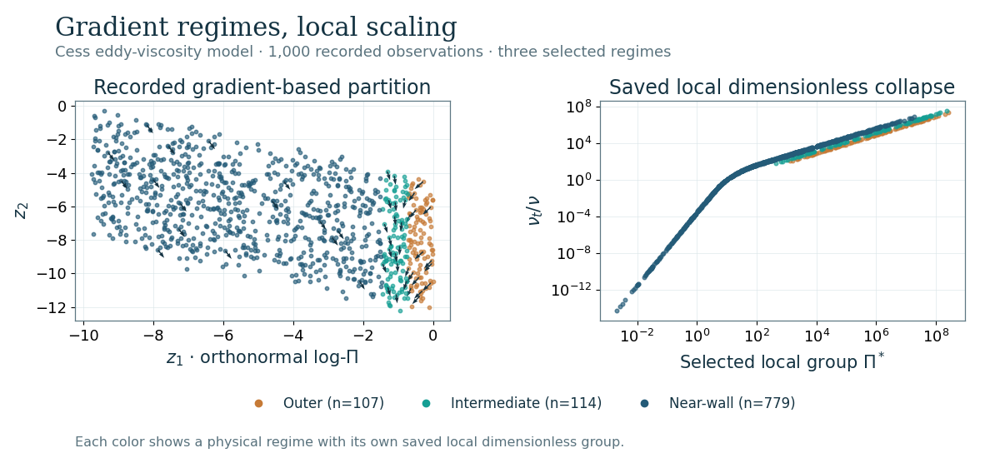
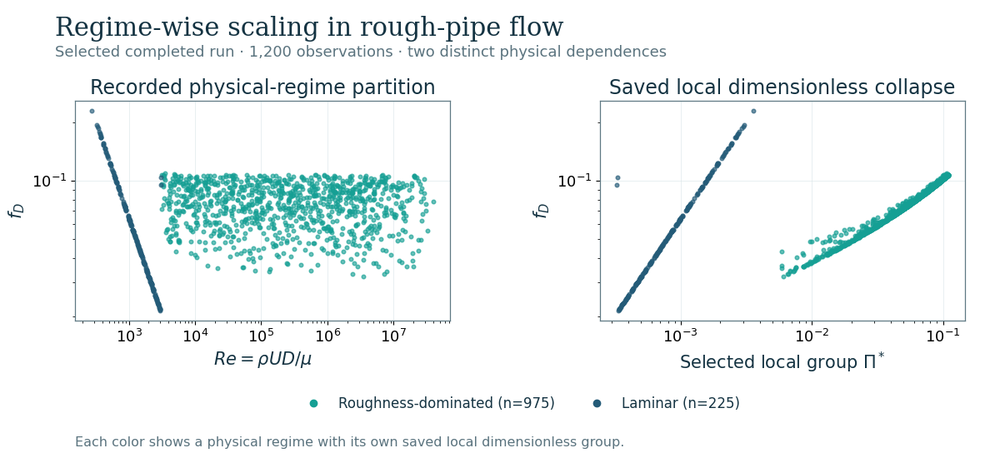
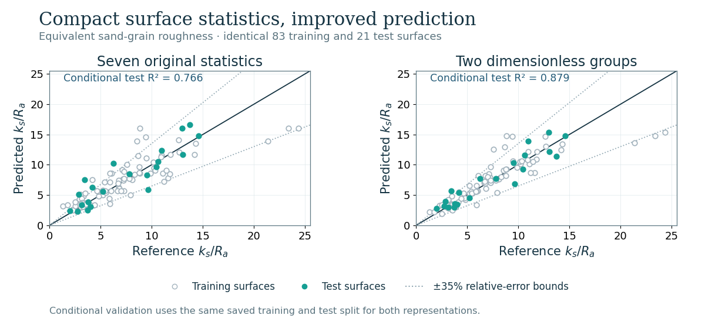
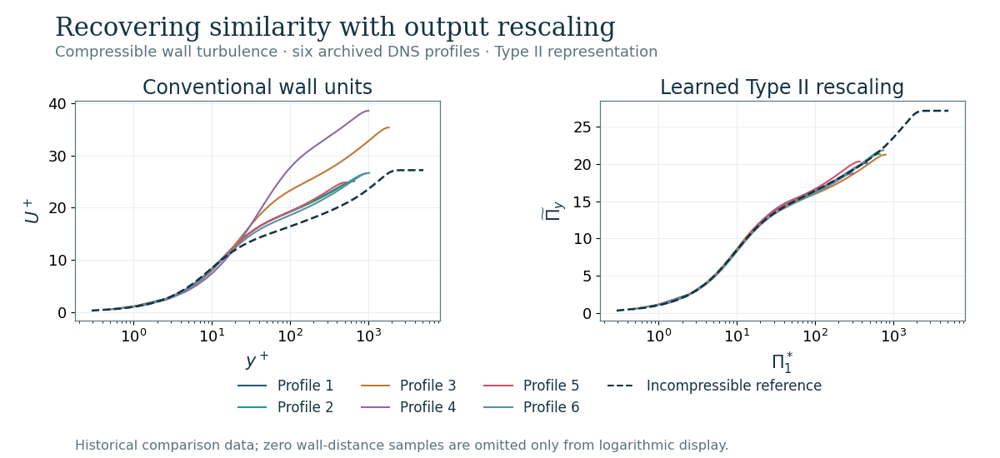

<div align="center">



**From physical questions and observations to interpretable dimensionless scaling.**

[](https://chengao21.github.io/ai-buckingham/)
[](notebooks/cases/)
[](https://ai-buckingham.streamlit.app/)
[](pyproject.toml)
[](LICENSE)

[Overview](#research-overview) · [Workflow](#workflow) · [Selected results](#selected-results) · [All ten cases](#all-ten-cases) · [Interactive explorer](#interactive-explorer) · [Reproduce](#reproduce-and-verify)

</div>

## Research overview

AI Buckingham discovers dimensionless representations from a physical problem description and observational data. LLM roles coordinate physical reasoning and tool calls; symbolic algebra constructs admissible Buckingham–Pi groups, and numerical criteria identify regimes, select similarity representations, simplify expressions and validate data collapse.

**Ao Cheng, Lei Zhang and Guowei He**

| Physical systems | Original observations | Executed case notebooks | Recorded CMA-ES generations |
|:---:|:---:|:---:|:---:|
| **10** | **4,926** | **10** | **9,853** |

The examples span fluid mechanics, magnetohydrodynamics, thermal convection and additive manufacturing. They cover Type I similarity, Type II output rescaling, and systems with multiple physical regimes.

## Workflow



The authors’ Figure 2 illustrates the workflow. Case-specific numerical results are reported below and in the linked result cards.

Two knowledge bases contain **247 physical quantities** and **251 dimensionless relations**. Retrieved records support dimensional checking and physical interpretation. Gradient-based clustering identifies local mechanisms; mutual information guides group-count selection, with sparsification and rationalization producing compact expressions. Result bundles include variable-level retrieval, dimensional ledgers, candidate partitions, optimizer traces and validation splits.

## Selected results

### A compact group from the admissible dimensionless space



For **483 MHD duct-flow observations**, the selected single-group representation reduces to an invertible form of the pressure–viscous parameter. The figure shows two views of the MI grid and the primary-seed coefficient trajectory. The full card also includes the dimensional basis and final collapse.

[MHD notebook](notebooks/cases/mhd.ipynb) · [Complete result card](https://chengao21.github.io/ai-buckingham/cards/mhd.html) · [Saved landscape](results/mi_landscapes/mhd/)

### Local mechanisms across a channel



The **Cess eddy-viscosity model** yields three regions: inner, transition and outer. Their retained groups recover wall scaling, a mixed inner–outer coordinate, and friction-Reynolds-number scaling, respectively.

[Cess notebook](notebooks/cases/cess_channel.ipynb) · [Complete result card](https://chengao21.github.io/ai-buckingham/cards/cess_channel.html) · [Regional comparison](reproduction/regime_comparison/)

### Regime-dependent pipe friction



For the **1,200-point rough-pipe benchmark**, two regions retain the groups **Re⁻¹** and **ε/D**. The dataset is generated from a piecewise relation with a prescribed switch at Re = 3000; the learned partition and its numerical evidence are available sample by sample.

[Rough-pipe notebook](notebooks/cases/rough_pipe.ipynb) · [Complete result card](https://chengao21.github.io/ai-buckingham/cards/rough_pipe.html) · [Execution configuration](docs/configuration.md)

### A useful roughness representation



On the same **83/21 train–test split**, two learned groups give conditional test **R² = 0.879**, compared with **0.766** for seven raw surface statistics. These scores evaluate the selected representations. Exact sample IDs, predictions and the declared `Sk + 2` preprocessing are included.

[Sandgrain notebook](notebooks/cases/sandgrain.ipynb) · [Complete result card](https://chengao21.github.io/ai-buckingham/cards/sandgrain.html) · [Prediction data](results/sandgrain_prediction/)

### Input and output rescaling for Type II similarity



For compressible channel and pipe profiles, the learned algebraic transformation applies density and viscosity corrections to both the wall coordinate and normalized velocity. The archived comparison includes six profiles and matched-coordinate errors.

[Velocity notebook](notebooks/cases/velocity_scaling.ipynb) · [Complete result card](https://chengao21.github.io/ai-buckingham/cards/velocity_scaling.html) · [Velocity comparison](reproduction/velocity_comparison/)

Figures and underlying data are available in the linked notebooks and result cards.

## All ten cases

| System | Observations | Similarity setting | Executed notebook | Full result |
|---|---:|---|---|---|
| MHD duct flow | 483 | Type I | [Notebook](notebooks/cases/mhd.ipynb) | [Card](https://chengao21.github.io/ai-buckingham/cards/mhd.html) |
| Pressure-gradient wall friction | 144 | Type I | [Notebook](notebooks/cases/pressure_gradient.ipynb) | [Card](https://chengao21.github.io/ai-buckingham/cards/pressure_gradient.html) |
| Rayleigh–Bénard convection | 182 | Type I | [Notebook](notebooks/cases/rayleigh_benard.ipynb) | [Card](https://chengao21.github.io/ai-buckingham/cards/rayleigh_benard.html) |
| Laser keyhole depth | 90 | Type I | [Notebook](notebooks/cases/laser_keyhole.ipynb) | [Card](https://chengao21.github.io/ai-buckingham/cards/laser_keyhole.html) |
| Blasius boundary layer | 200 | Type I | [Notebook](notebooks/cases/blasius.ipynb) | [Card](https://chengao21.github.io/ai-buckingham/cards/blasius.html) |
| Equivalent sand-grain roughness | 104 | Type I, two groups | [Notebook](notebooks/cases/sandgrain.ipynb) | [Card](https://chengao21.github.io/ai-buckingham/cards/sandgrain.html) |
| Compressible velocity scaling | 1,109 | Type II | [Notebook](notebooks/cases/velocity_scaling.ipynb) | [Card](https://chengao21.github.io/ai-buckingham/cards/velocity_scaling.html) |
| Goldenfeld rough-pipe scaling | 414 | Type II | [Notebook](notebooks/cases/goldenfeld.ipynb) | [Card](https://chengao21.github.io/ai-buckingham/cards/goldenfeld.html) |
| Cess channel eddy viscosity | 1,000 | Multiple regimes | [Notebook](notebooks/cases/cess_channel.ipynb) | [Card](https://chengao21.github.io/ai-buckingham/cards/cess_channel.html) |
| Rough circular pipe | 1,200 | Multiple regimes | [Notebook](notebooks/cases/rough_pipe.ipynb) | [Card](https://chengao21.github.io/ai-buckingham/cards/rough_pipe.html) |

Original row counts are listed above. Analysis-eligible counts and excluded zero responses are recorded separately. Dataset sources, generation methods and preprocessing are documented in [`data/README.md`](data/README.md).

## Interactive explorer

**[Open the browser-based results page](https://chengao21.github.io/ai-buckingham/)** to view the selected figures, explore all ten cases and open their complete result cards.

**[Open the Streamlit evidence explorer](https://ai-buckingham.streamlit.app/)** for detailed controls across the full workflow.

Browsing saved results requires no API credentials. New analyses require configured LLM and embedding services.

| View | What to inspect |
|---|---|
| Case workflow | Inputs, dimensional assignments, bases, resolved settings, local relations and full cards |
| Retrieval evidence | Variable-level queries, ranked records, score components and revision history |
| Numerical diagnostics | Gradients, candidate K partitions, MI landscapes and CMA-ES generation histories |
| Comparisons | Dimensional-checking trials, Cess regional relevance, velocity transforms and roughness predictions |
| Run analysis | A new model-backed LangGraph calculation with its own downloadable evidence bundle |

See the [application guide](docs/app.md) for browsing results and running new analyses.

## Run locally

Use **Python 3.12**, then run from the repository root:

```bash
python -m venv .venv
# Windows PowerShell: .venv\Scripts\Activate.ps1
# macOS / Linux: source .venv/bin/activate
python -m pip install -e ".[app,notebooks,dev]"
python -m streamlit run streamlit_app.py
```

Open [http://localhost:8501](http://localhost:8501), or use the [offline quickstart notebook](notebooks/quickstart.ipynb).

<details>
<summary><strong>Run a new complete analysis and configure model access</strong></summary>

Set credentials in the process environment using the names in [`.env.example`](.env.example). The application does not automatically load credential files. The default model is GPT-5 mini; embeddings use GLM-Embedding-3. Configure compatible endpoints through `OPENAI_BASE_URL` and `PARATERA_BASE_URL`.

```bash
ai-buckingham --list
ai-buckingham mhd
```

```python
from ai_buckingham import run_case

state = run_case("mhd")
```

Each new run saves its configuration, results, figures and execution trace under `generated/cases/<case_id>/<run_id>/`.

Custom configurations can be passed to `ai_buckingham.cli.run_analysis`. Case settings and numerical thread profiles are described in the [configuration guide](docs/configuration.md).

Complete agent runs and full-budget MI searches can take substantial time.

</details>

## Reproduce and verify

The repository includes **one verified complete execution per case**. Its **309 numerical acceptance checks** cover reported stage MI, epsilon, combined uncertainty, R², group counts and candidate partition counts. [Validation records](docs/validation/) and the [numerical summary](results/summary.csv) make the checks inspectable.

```bash
python -m pytest -q
python scripts/check_publication.py
python scripts/validate_results.py
python scripts/check_app.py
python scripts/check_web.py
python reproduction/verify_integrity.py
```

Four reproduction packages provide benchmark replay and numerical examples:

| Package | Included evidence |
|---|---|
| [Dimensional checking](reproduction/rag_ablation/) | 600 scheduled trials, 730 Checker rounds, initial/revised outcomes and API-use statistics |
| [Regime comparison](reproduction/regime_comparison/) | Cess regional relevance, recorded memberships and comparison settings |
| [Velocity comparison](reproduction/velocity_comparison/) | Six profiles, transformations and matched-coordinate errors |
| [MI landscapes](reproduction/mi_landscapes/) | Independent numerical notebooks and search configurations |

Saved results, offline recalculations and new analyses are labelled by source. Conditional collapse scores assess a selected representation. [Evidence and interpretation](docs/evidence.md) explains the relevant limits and equivalent power reparameterizations.

## Repository map

```text
src/ai_buckingham/       Scientific modules, execution interfaces and Streamlit views
configs/cases/          Exact case prompts, manual settings and native thread profiles
data/                   Ten datasets, provenance and supplied generators
knowledge/              Two knowledge bases and their GLM embedding NPZ indexes
notebooks/cases/        Ten complete executed LangGraph notebooks
results/                States, cards, tables, optimizer histories and original figures
reproduction/           Four benchmark and numerical reproduction packages
docs/assets/            Source-linked gallery figures, workflow image and SVG branding
site/                   Buildable static GitHub Pages results explorer
scripts/                Execution, validation and presentation builders
tests/                  Offline scientific and interface acceptance checks
streamlit_app.py        Interactive evidence explorer
```

See [numerical configuration](docs/configuration.md) for case settings and [repository layout](docs/repository-layout.md) for directory details.

## Citation and terms

If you use AI Buckingham in your research, please cite the following paper:

Ao Cheng, Lei Zhang and Guowei He. *AI Buckingham: Agentic Discovery of Dimensionless Scaling Laws Across Physical Regimes*. arXiv preprint arXiv:2611.33961 (2026). [doi:10.48550/arXiv.2611.33961](https://doi.org/10.48550/arXiv.2611.33961).

```bibtex
@article{cheng2026aibuckingham,
  title   = {{AI Buckingham}: Agentic Discovery of Dimensionless Scaling Laws Across Physical Regimes},
  author  = {Ao Cheng and Lei Zhang and Guowei He},
  journal = {arXiv preprint arXiv:2611.33961},
  year    = {2026},
  doi     = {10.48550/arXiv.2611.33961}
}
```

Citation metadata is also available in [`CITATION.cff`](CITATION.cff). Please acknowledge the original dataset sources you use. Original project code is released under the [MIT License](LICENSE); third-party terms are listed in [`THIRD_PARTY_NOTICES.md`](THIRD_PARTY_NOTICES.md).

## Acknowledgements

We thank GPT-6.2 (OpenAI), via Codex, for assistance with reproducibility checks, documentation editing and refinements to the results explorer interfaces. The authors reviewed the assisted work and retain full responsibility. We also thank the developers of the open-source tools and the contributors of the datasets acknowledged in this repository.
